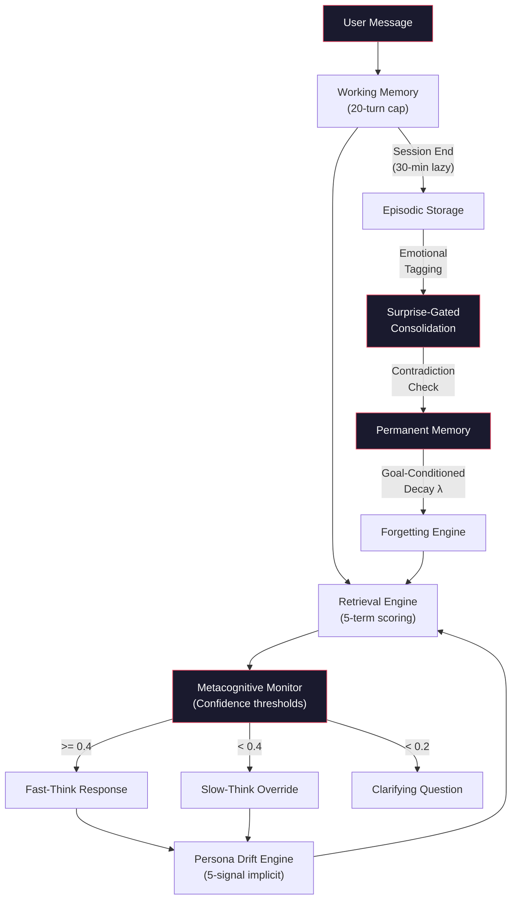

# CognAI — Research Landscape & Innovation Positioning

> **Scope**: All major research papers and frameworks from 2025–July 2026 mapped against CognAI's six core innovation pillars. Each section identifies what exists, what CognAI does differently, and the publishable gap.

---

## Table of Contents

1. [Long-Term Memory Architectures](#1-long-term-memory-architectures)
2. [Surprise-Gated Consolidation](#2-surprise-gated-consolidation)
3. [Metacognitive Self-Monitoring](#3-metacognitive-self-monitoring)
4. [Persona Drift & Adaptive Personality](#4-persona-drift--adaptive-personality)
5. [Emotional Valence in Memory Retrieval](#5-emotional-valence-in-memory-retrieval)
6. [Contradiction Detection & Memory Conflict Resolution](#6-contradiction-detection--memory-conflict-resolution)
7. [Goal-Conditioned Forgetting & Memory Decay](#7-goal-conditioned-forgetting--memory-decay)
8. [Cold Start Bootstrapping](#8-cold-start-bootstrapping)
9. [Benchmarks & Evaluation](#9-benchmarks--evaluation)
10. [CognAI's Unified Innovation — The Closed-Loop Claim](#10-cognais-unified-innovation--the-closed-loop-claim)

---

## 1. Long-Term Memory Architectures

### State of the Art (2025–2026)

| Paper / Framework | Key Contribution | Venue / Date | Link |
|:---|:---|:---|:---|
| **MemGPT → Letta** | "LLM OS" model — hierarchical memory paging between context windows and external storage. Now a full stateful agent SDK. | NeurIPS 2023 → Letta SDK 2026 | [arXiv:2310.08560](https://arxiv.org/abs/2310.08560) |
| **Mem0** | Production-ready memory layer with hybrid vector + keyword + entity + graph retrieval. Benchmarks well on LoCoMo & LongMemEval. | Mem0.ai, 2025–2026 | [mem0.ai](https://mem0.ai) |
| **A-MEM: Agentic Memory for LLM Agents** | Zettelkasten-inspired autonomous memory with dynamic linking, keyword tagging, and memory evolution. Superior to static baselines across 6 foundation models. | arXiv, Feb 2025 | [arXiv:2502.12110](https://arxiv.org/abs/2502.12110) |
| **Human-Inspired Memory Architecture** (Microsoft) | Six cognitive mechanisms: sleep-phase consolidation, engram maturation, reconsolidation upon retrieval. 97.2% retention precision with 58% storage reduction. | Microsoft Research, May 2026 | [arXiv:2605.08538](https://arxiv.org/abs/2605.08538) |
| **Memory for Autonomous LLM Agents: Mechanisms, Evaluation, and Emerging Frontiers** | Definitive survey — formalizes memory as a write–manage–read loop. Three-dimensional taxonomy (temporal scope, representational substrate, control policy). Identifies 5 mechanism families. | arXiv, March 2026 | [arXiv:2603.07670](https://arxiv.org/abs/2603.07670) |
| **CoALA: Cognitive Architectures for Language Agents** | Foundational framework from cognitive science: modular memory (working/episodic/semantic/procedural), structured action spaces, and generalized decision-making cycles. | arXiv, Sep 2023 | [arXiv:2309.02427](https://arxiv.org/abs/2309.02427) |
| **MemServe / MemPool** | Distributed KV cache management for LLM serving. Elastic MemPool with global scheduler and prompt-tree-based locality. Reduces serving latency for multi-user and agentic workflows. | arXiv, 2024–2025 | [arXiv:2404.14294](https://arxiv.org/abs/2404.14294) |
| **Zep** | Enterprise temporal memory with explicit "when was this true?" tracking. | Zep.ai, 2025–2026 | [zep.ai](https://www.getzep.com/) |
| **MAGMA** | Multi-agent graph-memory architecture for shared knowledge across agent swarms. | 2025–2026 | — |
| **Temporal Semantic Memory** (ACL 2026) | Explicitly tracks temporal validity of facts ("what was true then vs. now"). | ACL, 2026 | — |

### CognAI's Differentiation

> [!IMPORTANT]
> Most existing systems implement memory as an **isolated module** (a retrieval layer bolted onto a chat agent). CognAI's architecture is fundamentally different:
> - **Three-tier biological memory hierarchy** (Working → Episodic → Permanent/Semantic) with explicit transitions between tiers.
> - **Memory is not just stored — it actively shapes behavior**: episodic memories modulate persona drift, emotional valence modulates retrieval ranking, and surprise gates consolidation. No existing framework closes this loop.
> - Mem0 and Letta treat memory as a retrieval problem. CognAI treats memory as a **cognitive process** that includes forgetting, contradiction resolution, and emotional tagging as first-class operations.
> - **A-MEM** is the closest in spirit (autonomous memory evolution), but it focuses on link-based organization, not cognitive signal integration.
> - **CoALA** provides the theoretical blueprint CognAI builds upon, but CoALA is a framework taxonomy — CognAI is a concrete, engineered implementation.

---

## 2. Surprise-Gated Consolidation

### State of the Art (2025–2026)

| Paper | Key Contribution | Venue / Date | Link |
|:---|:---|:---|:---|
| **Titans: Learning to Memorize at Test Time** (Google Research) | Gradient-based surprise to gate memorization into neural long-term memory during inference. Scales to 2M+ tokens. Introduces MIRAS framework. | arXiv, Jan 2025 | [arXiv:2501.00663](https://arxiv.org/abs/2501.00663) |
| **Nested Learning / "Hope" Architecture** | Self-modifying, surprise-gated memory for unbounded in-context learning. Dissolves boundary between short-term (context) and long-term (weight) memory. | NeurIPS 2025 | [arXiv:2512.24695](https://arxiv.org/abs/2512.24695) |
| **SleepGate: Learning to Forget** | Maps biological sleep-dependent consolidation (synaptic downscaling, selective replay, active forgetting) onto LLM KV-cache management. Reduces interference horizon from O(n) to O(log n). | arXiv, March 2026 | [arXiv:2603.14517](https://arxiv.org/abs/2603.14517) |
| **SCM: Sleep-Consolidated Memory** | Multi-dimensional importance tagging + offline NREM/REM sleep-stage consolidation. 90.9% noise reduction, <1ms search latency. | arXiv, April 2026 | [arXiv:2604.20943](https://arxiv.org/abs/2604.20943) |
| **"Worth Remembering": Surprise-Gated Robot Episodic Memory** | Bayesian surprise as a gating mechanism in latent space (V-JEPA model) for robotic systems. ≥12% improvement on OC-NaVQA benchmark. | arXiv, June 2026 | [arXiv:2606.03787](https://arxiv.org/abs/2606.03787) |

### CognAI's Differentiation

> [!TIP]
> **Titans** and **Hope** implement surprise-gating at the **model weight level** (gradient-based). **SleepGate** and **SCM** implement it at the **training/offline level**. **CognAI implements surprise-gating at the application/retrieval level** using cosine distance against historical prior centroids — making it:
> 1. **Model-agnostic** — works with any LLM provider (Groq, Gemini, Qwen).
> 2. **Runtime-operational** — no retraining or sleep cycles required; surprise is computed per-session in real-time.
> 3. **Interpretable** — the surprise score is a transparent, debuggable scalar stored alongside every episodic memory.
>
> The "Worth Remembering" robotics paper (June 2026) is the closest analog, but it operates in a robotics latent space, not a conversational memory context.

---

## 3. Metacognitive Self-Monitoring

### State of the Art (2025–2026)

| Paper / Development | Key Contribution | Venue / Date | Link |
|:---|:---|:---|:---|
| **Yale NLP Metacognition Survey** | First comprehensive taxonomy of LLM metacognition: benchmarks, measurement methods, applications. | arXiv, July 2026 | [Yale NLP GitHub](https://github.com/yale-nlp/MetaCognition-LLM) |
| **Latent Confidence Alignment Error (LCAE)** | Measures consistency between model self-assessment and latent error probability, accounting for item difficulty. | arXiv, 2025–2026 | — |
| **Internal State Monitoring** | LLMs can report on a limited "metacognitive space" of their neural activity. Implications for safety and deceptive behavior. | NeurIPS 2025 | — |
| **Iterative Calibration** | Applying confidence checks at each reasoning step outperforms post-hoc calibration. Self-improvement loops can introduce "self-bias." | arXiv, 2026 | — |
| **Dual-Process (System 1/System 2) Controllers** | Modular controllers switch between fast and deliberative reasoning based on query complexity. | Various, 2025–2026 | — |
| **Metacognition-Driven LLM Frameworks** | Dissociate object-level reasoning from meta-level control. Embed explicit self-monitoring and self-regulation as architectural components. | Various, 2025–2026 | — |

### CognAI's Differentiation

> [!IMPORTANT]
> Existing metacognitive research is overwhelmingly focused on **model-internal calibration** (probing activations, fine-tuning confidence). CognAI's Metacognitive Monitor operates at the **system architecture level**:
> - It combines **retrieval coverage** (how well memory answers the query) + **persona certainty** (how stable the persona state is) into a single composite confidence score.
> - Concrete, operationalized thresholds: `≥ 0.4` → fast-think, `< 0.4` → slow-think override, `< 0.2` → clarifying question.
> - This is a **behavioral governor**, not a probing technique. It actively changes the system's response strategy in real-time, which no surveyed paper implements as an integrated architectural component.

---

## 4. Persona Drift & Adaptive Personality

### State of the Art (2025–2026)

| Paper | Key Contribution | Venue / Date | Link |
|:---|:---|:---|:---|
| **Fluid Personality Framework** (Rahman & Desai) | Jointly adapts agent's metaphorical persona and personality intensity based on task context, user goals, urgency. | AAAI 2026 (ABC Bridge Program) | [arXiv:2607.01034](https://arxiv.org/abs/2607.01034) |
| **JPAF (Jungian Personality Adaptation Framework)** | Jungian-psychology-based "dominant-auxiliary coordination" for core consistency with context-driven evolution. | GitHub/arXiv, 2026 | — |
| **Activation Steering / "Persona Vectors"** (Anthropic, Lu et al.) | Identifies "persona vectors" in activation space. Can steer models back to desired persona by vector arithmetic at inference. Defines the "Assistant Axis." | Anthropic 2026, arXiv 2026 | [Anthropic Research](https://www.anthropic.com/research) |
| **"Consistently Simulating Human Personas with Multi-Turn RL"** (Abdulhai et al.) | Uses RL to maintain character consistency over multi-turn conversations. | NeurIPS 2025 | — |
| **"Echo Mode" / Middleware Protocols** | Finite-state machines monitoring tone/structure to trigger persona recalibration when drift is detected. | Industry, 2026 | — |

### CognAI's Differentiation

> [!TIP]
> All existing persona work takes one of two approaches: **(a)** model-internal steering (activation vectors, RL fine-tuning) or **(b)** static personality assignments (system prompts, Jungian archetypes).
>
> CognAI's **5-Signal Implicit Persona Drift** is uniquely **data-driven and emergent**:
> 1. It measures 5 behavioral signals from the *user's own messages* (verbosity ratio, formality markers, question frequency, casual markers, topic return rate).
> 2. The agent's personality **mirrors** the user implicitly — no explicit persona assignment or model retraining required.
> 3. This is not "persona stability" (preventing drift); it is **controlled, intentional drift** toward the user's communication style, which no surveyed paper implements.

---

## 5. Emotional Valence in Memory Retrieval

### State of the Art (2025–2026)

| Paper / Framework | Key Contribution | Venue / Date | Link |
|:---|:---|:---|:---|
| **Affective Field Theory (AFT)** — `emotional_memory` | 5-layer model (semantic + valence/arousal + momentum + mood + appraisal) implementing mood-congruent retrieval. | GitHub, 2026 | [GitHub: emotional_memory](https://github.com/kambojankush/emotional_memory) |
| **Chain-of-Affective (LLMs-CoA)** | Derives "affective fingerprints" for LLM families to simulate emotional coping strategies. | arXiv, 2025–2026 | — |
| **Latent Structure of Affective Representations in LLMs** (Choi & Weber) | LLM "valence axis" aligns directionally with human EEG-recorded valence. LLMs form causally meaningful emotion representations. | arXiv, 2026 | [Transformer Circuits](https://transformer-circuits.pub/) |
| **LUFY / E-MXNet** | RAG systems that "forget" strategically to improve emotional support quality. | ACL, 2026 | — |
| **Ebbinghaus Forgetting Curve in RAG** | Applies psychological forgetting models to prioritize emotionally engaging memories. | Various, 2025–2026 | — |

### CognAI's Differentiation

> [!NOTE]
> AFT is the most comprehensive existing framework, but it is a **standalone retrieval layer** — it does not feed emotional signals back into consolidation, persona drift, or metacognitive confidence.
>
> CognAI's emotional valence tagging:
> - Stores `emotional_valence` (-1.0 to +1.0) and `emotional_intensity` (0.0 to 1.0) as **first-class database columns** on every episodic memory.
> - Uses a **constrained LLM scoring rubric** manually validated across providers (Groq ↔ Gemini) for cross-model consistency.
> - Emotional tags **modulate retrieval ranking** alongside semantic similarity, temporal relevance, surprise, and goal-relevance — making emotion one signal in a unified 5-term scoring function, not a separate retrieval pipeline.

---

## 6. Contradiction Detection & Memory Conflict Resolution

### State of the Art (2025–2026)

| Paper / Framework | Key Contribution | Venue / Date | Link |
|:---|:---|:---|:---|
| **ConflictRAG** | Systematic detect → classify → resolve → generate pipeline for RAG conflicts. 90.8% detection accuracy, 62% API cost reduction. Introduces CARS metric. | arXiv, May 2026 | [arXiv:2605.17301](https://arxiv.org/abs/2605.17301) |
| **GCR (Graph-Constrained Reasoning)** | Embeds KG structure into LLM decoding via "KG-Trie" to prevent hallucinations. | 2025–2026 | — |
| **ConflictQA** | Benchmark for testing LLM handling of contradictions between textual and KG evidence. | 2026 | — |
| **COCOA** (Confidence- & Context-Aware Decoding) | Token-level adaptive decoding for conflict resolution, rewarding consistency with logical paths. | 2026 | — |
| **KCR (Knowledge Conflict Reasoning)** | RL-based training to resolve inter-context conflicts via verified reasoning paths. | 2025 | — |
| **LOKA** | Conflict-aware knowledge updates with adaptive memory and versioned facts. | 2026 | — |

### CognAI's Differentiation

> [!IMPORTANT]
> Existing conflict resolution operates at the **retrieval/decoding level** — it resolves contradictions when they are encountered during a query. CognAI resolves contradictions at the **consolidation level** — during background memory merging:
> - The `MemoryConflictResolver` checks **new facts against the entire permanent memory store** before writing.
> - Uses the LLM itself (routed to Gemini/Qwen, not the chat model) to semantically resolve discrepancies.
> - This is **preventive**, not reactive — contradictions never enter the permanent store in the first place.
> - This approach is complementary to, and architecturally upstream of, frameworks like ConflictRAG.

---

## 7. Goal-Conditioned Forgetting & Memory Decay

### State of the Art (2025–2026)

| Paper / Framework | Key Contribution | Venue / Date | Link |
|:---|:---|:---|:---|
| **MemCon: Memory as a Controlled Process** | Models memory operations as an MDP; learns an online policy for consolidation/pruning. Zero additional LLM calls, converges in tens of tasks. Up to 15.2pt task success improvement. | arXiv, July 2026 | [arXiv:2607.13591](https://arxiv.org/abs/2607.13591) |
| **FadeMem: Biologically-Inspired Forgetting** | Dual-layer architecture with exponential decay modulated by semantic relevance, access frequency, temporal patterns. 45% storage reduction. | arXiv, Jan 2026 | [arXiv:2601.18642](https://arxiv.org/abs/2601.18642) |
| **Ebbinghaus-Inspired Forgetting Curves in RAG** | Usage-reinforced decay where recall frequency extends the "eviction horizon." | Various, 2025–2026 | — |
| **Mem0 Consolidation** | Semantic merging and pruning with intelligent forgetting in production. | 2025–2026 | [mem0.ai](https://mem0.ai) |
| **Titans / MIRAS** | Surprise-based storage prioritization — deviations from predictions are retained. | Google Research, 2025 | [arXiv:2501.00663](https://arxiv.org/abs/2501.00663) |

### CognAI's Differentiation

> [!TIP]
> **MemCon** learns forgetting policies via RL — powerful but opaque and requires training data. **FadeMem** uses fixed exponential decay. CognAI's approach is distinct:
> - Forgetting is **goal-conditioned**: the decay rate λ for each memory is modulated by its **cosine similarity to the user's current active goals**.
> - Memories relevant to active goals decay slowly; memories irrelevant to any active goal decay rapidly.
> - This creates a **biologically-motivated, interpretable, and training-free** forgetting mechanism that adapts dynamically as the user's goals evolve — without RL or offline optimization.

---

## 8. Cold Start Bootstrapping

### State of the Art (2025–2026)

| Paper / Framework | Key Contribution | Venue / Date | Link |
|:---|:---|:---|:---|
| **CAPE: Cold-start Adaptive Preference Elicitation** | Bayesian inference for targeted onboarding questions. Achieves 80.8% alignment (vs 68.5% for RL) with 3–5× fewer interactions. | ICML 2026 | [arXiv:2602.15012](https://arxiv.org/abs/2602.15012) |
| **Meta-Tuned Prompts (MAML)** | LLMs adapt to new users with 1–5 interactions. No parameter changes. | arXiv, 2025 | — |
| **Synthetic Data Bootstrapping** | Generating synthetic user profiles to seed recommendation engines for "day-one" personalization. | Various, 2025–2026 | — |
| **LLMTreeRec** | Tree-based retrieval for efficient cold-start recommendations without exhausting token budgets. | ACL, 2025 | — |

### CognAI's Differentiation

> [!NOTE]
> CognAI's cold start fix is pragmatically grounded:
> - During the first 5 sessions, the system injects an **"Onboarding/Bootstrap" prompt layer** that actively solicits goals and preferences.
> - These are **directly seeded into permanent memory**, bypassing the HDBSCAN clustering requirement entirely.
> - Unlike CAPE (which requires a population-level preference model), CognAI's approach is **zero-infrastructure** — it uses the existing LLM and memory pipeline, making it immediately deployable.

---

## 9. Benchmarks & Evaluation

### Key Benchmarks (2025–2026)

| Benchmark | Focus | Status | Link |
|:---|:---|:---|:---|
| **LongMemEval / LongMemEval-V2** | 5 core abilities: extraction, multi-session reasoning, knowledge updates, temporal reasoning, abstention. V2 targets web agents. | NeurIPS 2024 → V2 May 2026 | [arXiv:2410.10813](https://arxiv.org/abs/2410.10813) |
| **BEAM (Beyond a Million Tokens)** | 10+ memory abilities across 10M+ token conversations. Real-world scalability. | 2026 | — |
| **LoCoMo** | Factual recall, temporal reasoning, multi-hop inference across multi-session dialogues. | 2025–2026 | — |
| **MemoryAgentBench** | Accurate retrieval, test-time learning, long-range understanding, selective forgetting. Incremental multi-turn evaluation. | ICLR 2026 | [arXiv:2507.05257](https://arxiv.org/abs/2507.05257) |
| **Memora** (FAMA) | Forgetting-Aware Memory Accuracy — penalizes reliance on obsolete or invalidated information. | arXiv, April 2026 | [arXiv:2604.20006](https://arxiv.org/abs/2604.20006) |
| **TriMEM** | Multi-class memory type classification (episodic/semantic/procedural). | 2025–2026 | — |

### CognAI's Evaluation Strategy

> CognAI plans to benchmark on **LongMemEval** using synthetic data generated by a `simulate_users.py` script (100 sessions/user via an LLM "User Agent"). Beyond standard benchmark metrics, CognAI introduces a **multi-dimensional emergent evaluation framework** measuring properties that no current benchmark captures — including adaptive empathy, self-correcting memory accuracy, context-sensitive uncertainty calibration, long-term personality coherence, and cross-session goal prediction. This positions CognAI to contribute both a working system and a new evaluation paradigm.

---

## 10. CognAI's Innovation — Two-Layered Novelty

### Layer 1: Genuine Module-Level Novelty

CognAI is **not** merely a combination of existing techniques. While the research landscape has concurrent work in every area, several CognAI modules implement **genuinely novel mechanisms** that no existing paper replicates:

| Module | What Exists | What CognAI Does Differently | Why It's Novel |
|:---|:---|:---|:---|
| **5-Signal Persona Drift** | Every paper tries to *prevent* drift or *steer* a static persona (activation vectors, RL fine-tuning, system prompts) | CognAI *intentionally* drifts toward the user's communication style by measuring 5 implicit behavioral signals from the user's own messages | No paper implements **controlled, intentional user-mirroring drift**. This is a fundamentally different objective. |
| **Application-Level Surprise Gating** | Titans = gradient-level surprise. SleepGate = training-level. "Worth Remembering" = robotics latent space. | Cosine-distance surprise against historical prior centroids at the application layer — model-agnostic, real-time, interpretable | No paper computes surprise as a **transparent, debuggable, provider-independent scalar** at the retrieval/storage layer |
| **Preventive Contradiction Resolution** | ConflictRAG, COCOA, KCR all resolve contradictions *at query time* (during retrieval or decoding) | CognAI resolves contradictions *at write time* during background consolidation — contradictions never enter permanent memory | **Architecturally upstream** of all existing approaches. Preventive, not reactive. |
| **Goal-Conditioned Decay λ** | MemCon uses RL (opaque, requires training). FadeMem uses fixed exponential decay (not goal-aware). | Decay rate λ modulated by cosine similarity to the user's current active goals — training-free, interpretable, dynamically adapts | No paper implements **goal-aware, training-free forgetting** that adapts as user goals evolve |
| **Unified 5-Term Retrieval Scoring** | Systems use semantic similarity alone, or at most 2–3 signals | `(α·sim) + (β·goal_sim) + (γ·surprise) + (ε·temporal) - (δ·redundancy)` | No paper combines **semantic, goal-relevance, surprise, temporal, and redundancy** in a single scoring function |

### Layer 2: Emergent Closed-Loop Properties

Beyond module-level novelty, the closed-loop architecture produces **emergent properties** that cannot arise from any single module and go far beyond just goal prediction:

| Emergent Property | Interacting Modules | What Emerges |
|:---|:---|:---|
| **Adaptive Empathy** | Emotional valence → Persona drift → Response tone | The agent's empathy *evolves over months* based on accumulated emotional history — no static prompt or single-session tuning can produce this |
| **Self-Correcting Memory** | Contradiction detection + Goal-conditioned forgetting | Memory becomes more accurate *autonomously* over time — the system prunes its own errors and outdated facts without human intervention |
| **Context-Sensitive Uncertainty** | Metacognitive monitor + Retrieval coverage + Persona certainty | The system knows *when* it doesn't know, contextualized by *this specific user's* history — not just generic model-level calibration |
| **Long-Term Personality Coherence** | Persona drift + Working memory cap + Emotional tagging | Maintains a coherent, evolving personality across months of interaction — current agents regress to a generic baseline within single sessions |
| **Goal-Aware Attention** | Goal-conditioned forgetting + Surprise-gated consolidation | The system naturally focuses on what matters to the user *right now*, not what mattered 3 months ago — attention shifts dynamically with life changes |
| **Cross-Session Goal Prediction** | All modules simultaneously | Can predict what the user will ask about next — one measurable proxy for the full cognitive loop |

> [!CAUTION]
> **No existing system integrates all six cognitive signals into a single closed-loop architecture where each module's output feeds into the others. And no existing system produces these emergent behaviors.**

### The Publishable Research Claim

The claim is **two-layered**:

**Layer 1 (Module Novelty):** *"We introduce five novel mechanisms for long-term cognitive companions: (a) application-level surprise-gated consolidation, (b) intentional user-mirroring persona drift via 5 implicit behavioral signals, (c) preventive contradiction resolution at consolidation time, (d) goal-conditioned memory decay, and (e) a unified 5-term retrieval scoring function."*

**Layer 2 (Emergent System):** *"We demonstrate that the closed-loop integration of these mechanisms produces emergent cognitive properties — adaptive empathy, self-correcting memory, context-sensitive uncertainty, long-term personality coherence, and goal-aware attention — that significantly exceed any single-module ablation baseline across multiple evaluation dimensions."*

This is not a claim about combination alone. It is a claim about **novel individual mechanisms** whose **interaction produces emergent behaviors** that no module can produce in isolation.

---

## Summary: Research Gap Matrix

| CognAI Pillar | Closest Prior Art | Novelty Type | CognAI's Innovation |
|:---|:---|:---|:---|
| Surprise-Gated Consolidation | [Titans](https://arxiv.org/abs/2501.00663), [SleepGate](https://arxiv.org/abs/2603.14517) | **Mechanism** | Application-level, model-agnostic, real-time, interpretable — a genuinely different layer of operation |
| 5-Signal Persona Drift | [Fluid Personality](https://arxiv.org/abs/2607.01034), Activation Steering | **Mechanism** | Intentional user-mirroring (not drift prevention) — fundamentally different objective from all prior work |
| Preventive Contradiction Resolution | [ConflictRAG](https://arxiv.org/abs/2605.17301), COCOA | **Architecture** | Resolves at consolidation (write-time), not retrieval (read-time) — architecturally upstream |
| Goal-Conditioned Forgetting | [MemCon](https://arxiv.org/abs/2607.13591), [FadeMem](https://arxiv.org/abs/2601.18642) | **Mechanism** | Training-free, interpretable, goal-aware decay λ — no RL or fixed functions |
| Unified Retrieval Scoring | Individual signal papers | **Integration** | 5-term scoring (semantic + goal + surprise + temporal − redundancy) — no paper combines all five |
| Metacognitive Monitor | Yale NLP Survey, LCAE | **Architecture** | System-level behavioral governor with concrete thresholds, not a probing technique |
| Emotional Valence | [AFT](https://github.com/kambojankush/emotional_memory) | **Integration** | One signal in unified scoring, not a separate pipeline |
| Cold Start Bootstrap | [CAPE](https://arxiv.org/abs/2602.15012) | **Pragmatic** | Zero-infrastructure, uses existing LLM + memory pipeline |
| Emergent System Evaluation | [MemoryAgentBench](https://arxiv.org/abs/2507.05257) | **Evaluation** | Multi-dimensional emergent metrics: adaptive empathy, self-correcting memory, personality coherence, goal-aware attention |

> [!IMPORTANT]
> CognAI's novelty is **two-layered**: (1) several modules implement genuinely novel mechanisms (not just reimplementations), and (2) the closed-loop integration produces emergent cognitive properties that go far beyond goal prediction and cannot arise from any single module.

---

## Appendix: Quick-Reference Paper Index

All papers cited in this document, sorted alphabetically with direct links:

| # | Paper | arXiv / Link |
|:--|:---|:---|
| 1 | A-MEM: Agentic Memory for LLM Agents | [arXiv:2502.12110](https://arxiv.org/abs/2502.12110) |
| 2 | Affective Field Theory (emotional_memory) | [GitHub](https://github.com/kambojankush/emotional_memory) |
| 3 | CAPE: Cold-start Adaptive Preference Elicitation | [arXiv:2602.15012](https://arxiv.org/abs/2602.15012) |
| 4 | CoALA: Cognitive Architectures for Language Agents | [arXiv:2309.02427](https://arxiv.org/abs/2309.02427) |
| 5 | ConflictRAG | [arXiv:2605.17301](https://arxiv.org/abs/2605.17301) |
| 6 | FadeMem: Biologically-Inspired Forgetting | [arXiv:2601.18642](https://arxiv.org/abs/2601.18642) |
| 7 | Fluid Personality Framework (Rahman & Desai) | [arXiv:2607.01034](https://arxiv.org/abs/2607.01034) |
| 8 | Human-Inspired Memory Architecture (Microsoft) | [arXiv:2605.08538](https://arxiv.org/abs/2605.08538) |
| 9 | LongMemEval | [arXiv:2410.10813](https://arxiv.org/abs/2410.10813) |
| 10 | MemCon: Memory as a Controlled Process | [arXiv:2607.13591](https://arxiv.org/abs/2607.13591) |
| 11 | MemGPT → Letta | [arXiv:2310.08560](https://arxiv.org/abs/2310.08560) |
| 12 | Memora (FAMA Benchmark) | [arXiv:2604.20006](https://arxiv.org/abs/2604.20006) |
| 13 | Memory for Autonomous LLM Agents (Survey) | [arXiv:2603.07670](https://arxiv.org/abs/2603.07670) |
| 14 | MemoryAgentBench | [arXiv:2507.05257](https://arxiv.org/abs/2507.05257) |
| 15 | MemServe / MemPool | [arXiv:2404.14294](https://arxiv.org/abs/2404.14294) |
| 16 | Nested Learning / HOPE Architecture | [arXiv:2512.24695](https://arxiv.org/abs/2512.24695) |
| 17 | SCM: Sleep-Consolidated Memory | [arXiv:2604.20943](https://arxiv.org/abs/2604.20943) |
| 18 | SleepGate: Learning to Forget | [arXiv:2603.14517](https://arxiv.org/abs/2603.14517) |
| 19 | Titans: Learning to Memorize at Test Time | [arXiv:2501.00663](https://arxiv.org/abs/2501.00663) |
| 20 | Worth Remembering: Surprise-Gated Robot Memory | [arXiv:2606.03787](https://arxiv.org/abs/2606.03787) |

https://arxiv.org/html/2604.11364v2
